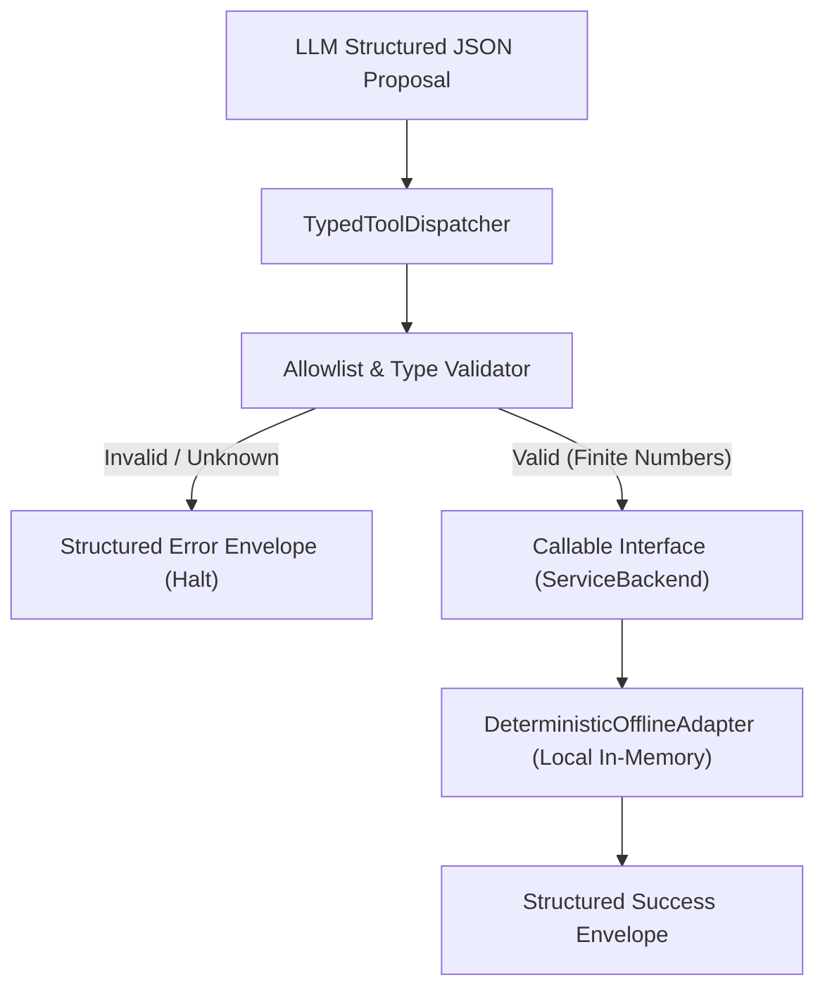

# R40-T025: Typed Tool Dispatch — Offline Service Adapter

## Overview

In AI Agent architectures, Large Language Models (LLMs) plan actions by generating structured tool calls (such as JSON function calling schemas or Model Context Protocol [MCP] tool invocations). Because model outputs are probabilistic and inherently untrusted, the agent runtime must enforce defensive boundaries before dispatching any call to underlying services:
1. **Explicit Allowlist:** Restrict tool execution to verified, registered capabilities (`add` and `multiply`).
2. **Strict Schema & Type Validation:** Reject invalid primitives (such as strings or booleans) before tool execution.
3. **Structured Error Envelopes:** Return uniform, machine-readable JSON status envelopes for both successful executions and errors.
4. **Execution Halting & Failure Isolation:** In multi-step agent plans, ensure that a failed call immediately halts execution and cannot execute subsequent tools.
5. **Callable Interface & Deterministic Local Adapter:** Place external dependencies (e.g., remote microservices or cloud APIs) behind a callable interface, and provide a deterministic local adapter for fast, reproducible, offline execution.

This lab demonstrates these concepts using a self-contained local contract fixture implemented with Python's standard library.

---

## Requirements & Scope

- **Runtime:** Python 3.9+ (Python 3.15 tested)
- **Dependencies:** Python standard library only (`abc`, `argparse`, `json`, `math`, `os`, `subprocess`, `sys`, `typing`, `unittest`)
- **Infrastructure:** Zero external dependencies. No model downloads, paid provider credentials, GPUs, network connectivity, or physical devices are required.
- **Contract Fixture vs. Full Transport:** This lab is a local contract fixture demonstrating dispatch semantics and offline adapter design. It is **not** a full Model Context Protocol (MCP) transport implementation (it does not implement JSON-RPC 2.0 message framing, stdio/SSE socket transports, or session negotiation daemons).

---

## Architecture: Callable Interface and Offline Adapter

In enterprise agent frameworks (such as LangChain, AutoGen, and Microsoft Agent Framework), tools frequently interact with external dependencies (e.g., cloud arithmetic engines, search APIs, databases). Coupling the dispatcher directly to network calls introduces test flakiness, credential management friction, and rate limiting issues during development.

This lab places external execution behind an explicit callable interface:



### Callable Interface Definition

```python
class ArithmeticServiceProtocol(Protocol):
    def __call__(
        self, operation: str, a: Union[int, float], b: Union[int, float]
    ) -> Union[int, float]:
        ...
```

The dispatcher delegates arithmetic execution to any backend conforming to this callable contract.

---

## Real-Service Behaviors This Mock Does NOT Establish

A critical aspect of using deterministic offline adapters is knowing where the simulation stops. The local adapter reproduces deterministic business logic in-memory, but it explicitly **does not establish** real-world distributed system characteristics:

| Category | Offline Mock Behavior | Real-Service Behavior (Not Established) | Production Counterpart |
|---|---|---|---|
| **1. Latency & Jitter** | Synchronous execution (~0ms delay). | Variable network round-trip time (RTT), packet queuing, latency percentiles (p50/p95/p99), and bandwidth limits. | TCP/HTTP/gRPC network stacks with timeout envelopes. |
| **2. Transient Network Faults** | In-process calls never drop packets. | Dropped packets, socket disconnects, DNS timeouts, TLS handshake resets, half-open socket hangs. | Transport retry policies, exponential backoff, circuit breakers. |
| **3. Auth & Authorization** | No authentication tokens or credentials required. | OAuth2 bearer token negotiation, API keys, HMAC signatures, mTLS client certificates, IAM RBAC roles. | Identity providers (Azure Entra, Okta) and cloud IAM checks. |
| **4. Rate Limiting & Contention** | Unbounded sequential execution without throttling. | HTTP 429 Too Many Requests, token bucket/leaky bucket rate limits, concurrent thread pool exhaustion. | API gateway rate limiters and distributed quota managers. |
| **5. Distributed State & Idempotency** | In-memory local state without replication. | Distributed transactions, two-phase commits, replication lag, eventual consistency drift, idempotency key deduplication. | Distributed consensus engines (Raft), message queues (Kafka). |
| **6. Downstream Outages** | Always available in-process. | HTTP 500 Internal Error, 502 Bad Gateway, 503 Service Unavailable, 504 Gateway Timeout downstream dependency failures. | Health check probes, blue/green deployments, automated failover. |
| **7. Hardware Heterogeneity** | Pure host CPU Python execution. | GPU/TPU accelerator precision differences, SIMD vectorization, container cold-starts, memory limits. | Cloud VM instances, container orchestrators (Kubernetes). |
| **8. LLM Probabilistic Drift** | Deterministic JSON payload dispatch. | Stochastic LLM output variation, prompt injection attacks, context window overflow, hallucinations. | Guardrail services, temperature sampling controls, output validators. |

To inspect this catalog via the CLI:
```bash
python3 17-ai-agents/applied-labs/r40-t025/example.py --show-service-gaps
```

---

## Local Contract & Boundary Decisions

### 1. Declared Tools in Allowlist

| Tool | Parameters | Description | Example Input | Expected Output |
|---|---|---|---|---|
| `add` | `a` (number), `b` (number) | Calculates arithmetic sum | `{"a": 2, "b": 3}` | `5` |
| `multiply` | `a` (number), `b` (number) | Calculates arithmetic product | `{"a": 2, "b": 3}` | `6` |

Any tool not in `["add", "multiply"]` is rejected with `UnknownToolError` (`TOOL_NOT_ALLOWED`).

### 2. Boundary Decisions & Rationale

- **Booleans (`bool`):** In Python, `isinstance(True, int)` evaluates to `True`. However, in JSON and tool schemas, boolean is a distinct primitive (`true`/`false`). Coercing boolean to numeric `1`/`0` is unsafe in agent tool dispatch. Therefore, booleans are strictly rejected (`INVALID_ARGUMENT_TYPE`).
- **Numeric Strings:** Strings (e.g. `"2"`) are strictly rejected. Automatic coercion masks model schema drift and introduces ambiguity between string concatenation and arithmetic.
- **Non-Finite Floats:** Standard JSON (RFC 8259) prohibits `NaN`, `Infinity`, and `-Infinity`. Non-finite floats violate discrete arithmetic contracts and are rejected (`NON_FINITE_NUMERIC_VALUE`).
- **Pipeline Failure Halting:** When executing a multi-step tool sequence, a failed call immediately halts execution. All subsequent calls are aborted and cannot execute another tool.

---

## Running the Lab

### 1. Normal Scenarios

#### Addition: `add(2, 3) -> 5`

```bash
python3 17-ai-agents/applied-labs/r40-t025/example.py --call '{"tool": "add", "arguments": {"a": 2, "b": 3}}'
```

Output:
```json
{
  "status": "success",
  "tool": "add",
  "arguments": {
    "a": 2,
    "b": 3
  },
  "result": 5
}
```
Exit code: `0`

#### Multiplication: `multiply(2, 3) -> 6`

```bash
python3 17-ai-agents/applied-labs/r40-t025/example.py --call '{"tool": "multiply", "arguments": {"a": 2, "b": 3}}'
```

Output:
```json
{
  "status": "success",
  "tool": "multiply",
  "arguments": {
    "a": 2,
    "b": 3
  },
  "result": 6
}
```
Exit code: `0`

---

### 2. Failure Scenarios

#### Unknown Tool

```bash
python3 17-ai-agents/applied-labs/r40-t025/example.py --call '{"tool": "divide", "arguments": {"a": 6, "b": 2}}'
```

Output:
```json
{
  "status": "error",
  "error": {
    "type": "UnknownToolError",
    "code": "TOOL_NOT_ALLOWED",
    "message": "Tool 'divide' is not permitted in allowlist. Allowed tools: ['add', 'multiply']",
    "details": {
      "tool": "divide",
      "allowed_tools": [
        "add",
        "multiply"
      ]
    }
  },
  "tool": "divide",
  "arguments": {
    "a": 6,
    "b": 2
  }
}
```
Exit code: `1`

#### String Argument `a`

```bash
python3 17-ai-agents/applied-labs/r40-t025/example.py --call '{"tool": "add", "arguments": {"a": "2", "b": 3}}'
```

Output:
```json
{
  "status": "error",
  "error": {
    "type": "ValidationError",
    "code": "INVALID_ARGUMENT_TYPE",
    "message": "Argument 'a' must be a finite number (int or float), got str: \"2\"",
    "details": {
      "parameter": "a",
      "expected": "finite number (int or float)",
      "received_type": "str",
      "received_value": "2"
    }
  },
  "tool": "add",
  "arguments": {
    "a": "2",
    "b": 3
  }
}
```
Exit code: `1`

---

### 3. Pipeline Failure Halting / Failure Isolation

To verify that a failed call cannot execute another tool:

```bash
python3 17-ai-agents/applied-labs/r40-t025/example.py --pipeline '[{"tool": "add", "arguments": {"a": "invalid", "b": 3}}, {"tool": "multiply", "arguments": {"a": 2, "b": 3}}]'
```

Output:
```json
{
  "status": "error",
  "pipeline_halted": true,
  "failed_step_index": 0,
  "completed_steps": 0,
  "total_steps": 2,
  "executed_results": [],
  "failed_call": {
    "status": "error",
    "error": {
      "type": "ValidationError",
      "code": "INVALID_ARGUMENT_TYPE",
      "message": "Argument 'a' must be a finite number (int or float), got str: \"invalid\"",
      "details": {
        "parameter": "a",
        "expected": "finite number (int or float)",
        "received_type": "str",
        "received_value": "invalid"
      }
    },
    "tool": "add",
    "arguments": {
      "a": "invalid",
      "b": 3
    }
  },
  "aborted_calls": [
    {
      "tool": "multiply",
      "arguments": {
        "a": 2,
        "b": 3
      }
    }
  ],
  "message": "Pipeline halted: a failed call cannot execute another tool."
}
```
Exit code: `1`

---

## Automated Unit Tests

Run the test suite from the repository root:

```bash
python3 -m unittest discover -s 17-ai-agents/applied-labs/r40-t025 -p "test_*.py" -v
```

All 31 unit, boundary, integration, and subprocess tests execute in-memory with zero external dependencies and report `OK`.
